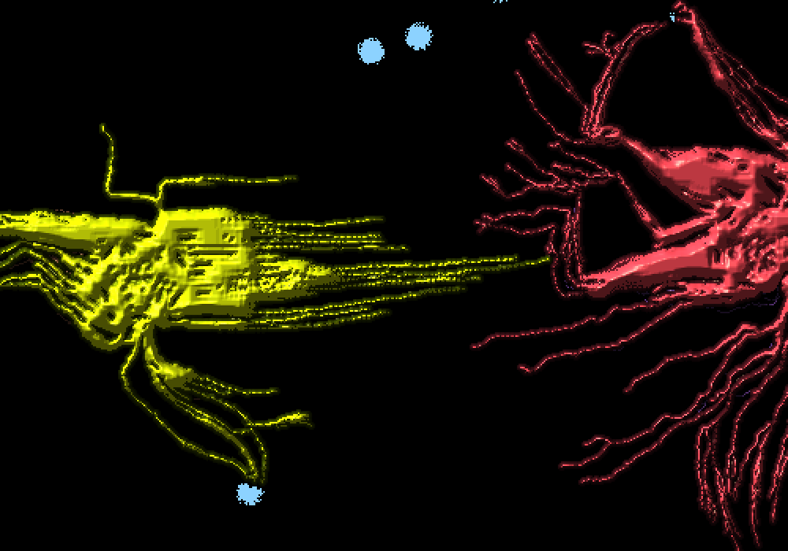

# Physarum RTS

Simulación en el navegador de **Physarum polycephalum** (el moho mucilaginoso amarillo) sobre una matriz de píxeles, convertida en un pequeño **juego de estrategia en tiempo real**: tu colonia crece buscando comida, se ramifica, forma redes de venas y compite contra una colonia enemiga.


No hay dependencias ni paso de compilación: son dos archivos estáticos.

## Cómo ejecutarlo

Descarga el repositorio y abre `physarum.html` en el navegador (doble clic).
`physarum.html` carga `physarum_core.js`, así que **deben estar en la misma carpeta**.

También puedes servirlo, por ejemplo:

```bash
python3 -m http.server 8000   # y abre http://localhost:8000/physarum.html
```

## Controles

| Acción | Efecto |
| --- | --- |
| **Botón derecho** + arrastrar | Mover la cámara (el mundo no tiene límite) |
| **Rueda** | Zoom ×1 a ×6 (el punto bajo el ratón no se mueve) |
| **H** / botón *Centrar* | Volver a tu colonia |
| **1 · Mover** + clic izq. | Marca un objetivo: tus puntas del lado del objetivo avanzan hacia él |
| **2 · Atacar** + clic izq. | Igual, pero busca venas y núcleo enemigos y multiplica el daño |
| **3 · Comida** + clic izq. | Pinta comida (con **Mayús** la borra) |
| **Esc** | Cancela el objetivo |

El panel lateral muestra el estado de ambas colonias (material, puntas, comido, robado, perdido, ramas cortadas, núcleo restante) y tiene sliders para velocidad, relieve, comida aleatoria (cantidad y concentración), agresividad del enemigo, daño de ataque y material inicial.



## Cómo funciona

El crecimiento no es un autómata celular ni un modelo de agentes con rastro químico (esos colapsan en pocos canales gruesos y no se parecen a la forma real). Es un **modelo explícito de crecimiento de red**:

- **Núcleo y puntas.** Cada colonia tiene un núcleo denso. De él salen *puntas* de pseudópodo que avanzan, se ramifican al azar (autorregulado según el perímetro del frente) y dejan una **vena permanente**: un árbol de nodos, uno por píxel.
- **Fusión (anastomosis).** Una punta que choca con una vena *propia* se conecta y termina; así aparecen la malla y los huecos. El frente es lobulado porque la velocidad depende del ángulo.
- **Material conservado.** Cada colonia tiene una cantidad total de material. Cada píxel de vena cuesta material. Si no queda libre, las puntas esperan y la colonia **seca ramas externas** (las más lejanas a la comida o al objetivo), que dejan un píxel apagado. Así la colonia puede desplazarse sin crecer sin límite.
- **Comida.** Se consume poco a poco, suma material y engrosa y protege la rama que la come. Al encontrarla, la colonia entra en modo *hallazgo*: las otras ramas se retraen y el material liberado refuerza el camino que llegó a la comida. La detección es de corto alcance: por defecto la colonia es radial. Una punta solo "ve" comida si no hay una vena viva en medio.
- **Combate.** Una punta que toca una vena enemiga compara su **fuerza** (la materia de su rama, × orden de ataque) con la del enemigo: si tiene más, la corta y sigue por encima; si no, muere y la daña. Todo lo que colgaba de una rama cortada queda huérfano y se seca; el atacante absorbe parte de ese material. Cerca del propio núcleo las ramas son hasta ×3 más difíciles de cortar.
- **Núcleo.** Se come píxel a píxel y cada píxel da material al atacante. Una colonia con menos del 10 % de núcleo es derrotada. Si queda aniquilada pero con núcleo, rebrota con un poco de material.
- **Mundo sin límite.** La matriz crece (256 px por lado) cuando una punta se acerca al borde, con un tope de memoria configurable (`maxCells`). La cámara solo pinta lo visible.
- **Render.** Venas amarillas (la enemiga, roja) sobre una membrana tenue; las ramas secas quedan como píxeles apagados. El relieve es un *normal map* calculado en vivo: más densidad, más altura, con luz direccional y brillo especular.

## Estructura

```
physarum.html        interfaz, cámara, entrada y render (canvas + relieve)
physarum_core.js     simulación (sin DOM): mundo, colonias, comida, combate, crecimiento
docs/                capturas
```

`physarum_core.js` no depende del navegador: se puede cargar en Node (`require`) para hacer pruebas sin interfaz. Todos los parámetros están en `PHYS_DEFAULTS`.

## Parámetros útiles

Están al final de `physarum_core.js`, en `PHYS_DEFAULTS`:

| Parámetro | Qué controla |
| --- | --- |
| `startMass` | Material inicial de cada colonia |
| `foodRange`, `foodPull` | Sensibilidad a la comida (alcance y fuerza de atracción) |
| `foodPct`, `foodConc` | Comida aleatoria: % del mapa y tamaño de las manchas |
| `attackMult`, `coreStrength`, `homeBonus` | Equilibrio del combate |
| `orphanLoot`, `loot`, `coreValue` | Cuánto material se lleva el atacante |
| `focusTime`, `focusExplore`, `reinforce` | Modo *hallazgo* tras encontrar comida |
| `maxCells` | Tope de tamaño del mundo (memoria) |

## Estado

Prototipo. El equilibrio entre jugador y enemigo está sin ajustar: la IA solo crece con un sesgo hacia tu núcleo, y con las órdenes de mover y atacar el material que gastas lo pierdes en otro sitio, así que atacar y defender son un compromiso. Se ha probado con scripts de Node y con un DOM simulado; faltan más pruebas en navegadores reales.

Ideas pendientes: órdenes por zonas, gastar material en refuerzos, minimapa, varios enemigos.

## Referencia

Modelos de redes de Physarum: Tero et al., *Rules for Biologically Inspired Adaptive Network Design*, Science 327 (2010); Jones, *Characteristics of pattern formation and evolution in approximations of Physarum transport networks*, Artificial Life 16 (2010).

## Licencia

[MIT](LICENSE) © 2026 Tyxop.
