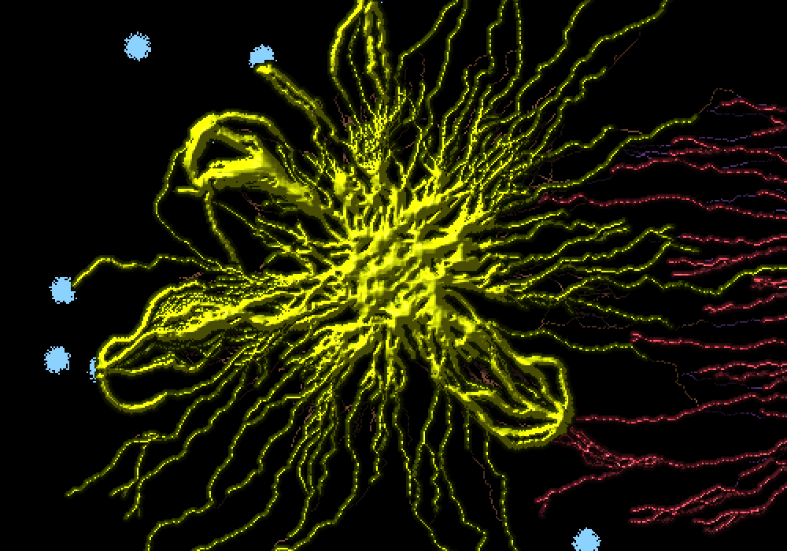

# Physarum RTS

Simulación en el navegador de **Physarum polycephalum** (el moho mucilaginoso amarillo) sobre una matriz de píxeles, convertida en un pequeño **juego de estrategia en tiempo real**: tu colonia crece buscando comida, se ramifica, forma redes de venas y compite contra una colonia enemiga.



No hay dependencias ni paso de compilación: son dos archivos estáticos.

## Cómo ejecutarlo

Descarga el repositorio y abre `physarum.html` en el navegador (doble clic).
`physarum.html` carga `physarum_core.js`, así que **deben estar en la misma carpeta**.

También puedes servirlo, por ejemplo:

```bash
python3 -m http.server 8000   # y abre http://localhost:8000/physarum.html
```

## Controles

| Acción | Efecto |
| --- | --- |
| **Botón derecho** + arrastrar | Mover la cámara (el mundo no tiene límite) |
| **Rueda** | Zoom ×1 a ×6 (el punto bajo el ratón no se mueve) |
| **H** / botón *Centrar* | Volver a tu colonia |
| **1 · Mover** + clic izq. | Marca un objetivo: la colonia lanza una *lanza* de puntas hacia él (arrastrar lo mueve) |
| **2 · Atacar** + clic izq. | Igual, pero busca venas y núcleo enemigos, multiplica el daño y asedia el núcleo |
| **3 · Comida** + clic izq. | Pinta comida (con **Mayús** la borra) |
| **Esc** | Cancela el objetivo |

El panel lateral muestra el estado de ambas colonias (material, puntas, comido, robado, perdido, ramas cortadas, núcleo restante) y tiene sliders para velocidad, relieve, comida aleatoria (cantidad y concentración), agresividad del enemigo, daño de ataque y material inicial.


## Cómo funciona

El crecimiento no es un autómata celular ni un modelo de agentes con rastro químico (esos colapsan en pocos canales gruesos y no se parecen a la forma real). Es un **modelo explícito de crecimiento de red**:

- **Núcleo y puntas.** Cada colonia tiene un núcleo denso. De él salen *puntas* de pseudópodo que avanzan, se ramifican al azar (autorregulado según el perímetro del frente) y dejan una **vena permanente**: un árbol de nodos, uno por píxel.
- **Fusión (anastomosis).** Una punta que choca con una vena *propia* se conecta y termina; así aparecen la malla y los huecos. El frente es lobulado porque la velocidad depende del ángulo.
- **Material conservado.** Cada colonia tiene una cantidad total de material. Cada píxel de vena cuesta material. Si no queda libre, las puntas esperan y la colonia **seca ramas externas** (las más lejanas a la comida o al objetivo), que dejan un píxel apagado. Así la colonia puede desplazarse sin crecer sin límite.
- **Comida.** Se consume poco a poco, suma material y engrosa y protege la rama que la come. Al encontrarla, la colonia entra en modo *hallazgo*: las otras ramas se retraen y el material liberado refuerza el camino que llegó a la comida. La detección es de corto alcance: por defecto la colonia es radial. Una punta solo "ve" comida si no hay una vena viva en medio.
- **Fuerza de rama.** Cada nodo tiene una *fuerza* propia, independiente del coste en material: se hereda a lo largo de la rama (una rama alimentada sigue siendo fuerte mucho después) y crece con la comida y con el material que se le redirige. Que sea independiente del coste evita que una rama gruesa se quede sin material para avanzar.
- **Combate.** Una punta que toca una vena enemiga compara su fuerza (× `attackMult` con orden de ataque) con la del nodo enemigo: si tiene más, **lo corta y sigue por encima**; si no, muere y solo lo daña. Al cortar un nodo, **todo su subárbol se seca al instante** (no queda materia sólida que bloquee) y el atacante absorbe el nodo y parte del resto (`orphanLoot`). Cerca del propio núcleo las ramas son hasta ×3 más difíciles de cortar (`homeBonus`).
- **Órdenes.** Con un objetivo activo solo avanza la **vanguardia** (las puntas más cercanas al objetivo, `vanBand`); la retaguardia se queda quieta sin gastar y el material de las ramas lejanas que se secan engorda la rama de la punta que va delante. Si la vanguardia se queda corta, nacen puntas nuevas desde las hojas más cercanas al objetivo (`minVan`). Con *atacar*, además, las puntas huelen venas enemigas por delante y, cerca del núcleo (**asedio**), van al píxel de núcleo que queda más cerca y no se fusionan con sus propias venas.
- **Núcleo.** Se come píxel a píxel y cada píxel da material al atacante. Una colonia con menos del 10 % de núcleo es derrotada. Si queda aniquilada pero con núcleo, rebrota con un poco de material.
- **Mundo sin límite.** La matriz crece (256 px por lado) cuando una punta se acerca al borde, con un tope de memoria configurable (`maxCells`). La cámara solo pinta lo visible.
- **Render.** Venas amarillas (la enemiga, roja) sobre una membrana tenue; las ramas secas quedan como píxeles apagados. El relieve es un *normal map* calculado en vivo: más densidad, más altura, con luz direccional y brillo especular.

## Estructura

```
physarum.html        interfaz, cámara, entrada y render (canvas + relieve)
physarum_core.js     simulación (sin DOM): mundo, colonias, comida, combate, crecimiento
docs/                capturas
```

`physarum_core.js` no depende del navegador: se puede cargar en Node (`require`) para hacer pruebas sin interfaz. Todos los parámetros están en `PHYS_DEFAULTS`.

## Parámetros útiles

Están al final de `physarum_core.js`, en `PHYS_DEFAULTS`:

| Parámetro | Qué controla |
| --- | --- |
| `startMass` | Material inicial de cada colonia |
| `foodRange`, `foodPull` | Sensibilidad a la comida (alcance y fuerza de atracción) |
| `foodPct`, `foodConc` | Comida aleatoria: % del mapa y tamaño de las manchas |
| `attackMult`, `coreStrength`, `homeBonus`, `homeRadius` | Equilibrio del combate (fuerza del ataque, del núcleo y ventaja de territorio) |
| `inherit`, `strGain`, `strMax` | Cuánto se hereda y crece la fuerza de una rama |
| `vanBand`, `minVan`, `reserve` | Vanguardia: anchura del frente, nº mínimo de puntas y reserva de material |
| `orphanLoot`, `loot`, `coreValue` | Cuánto material se lleva el atacante |
| `focusTime`, `focusExplore`, `reinforce` | Modo *hallazgo* tras encontrar comida |
| `maxCells` | Tope de tamaño del mundo (memoria) |

## Estado

Prototipo. Se ha probado con scripts de Node (incluidas comprobaciones de consistencia del árbol de nodos tras miles de cortes) y con un DOM simulado; faltan más pruebas en navegadores reales.

El equilibrio está sin ajustar: la IA enemiga solo crece con un sesgo hacia tu núcleo, **no se defiende ni contraataca**, así que una orden de atacar bien dirigida suele derrotarla (en las pruebas, en torno a 1300–1500 pasos). Al marcar una orden la colonia se estrecha en una lanza y el lado de casa queda expuesto. Los parámetros de arriba sirven para endurecerla.

Ideas pendientes: IA enemiga que defienda y contraataque, órdenes por zonas, gastar material en refuerzos, minimapa, varios enemigos.

## Referencia

Modelos de redes de Physarum: Tero et al., *Rules for Biologically Inspired Adaptive Network Design*, Science 327 (2010); Jones, *Characteristics of pattern formation and evolution in approximations of Physarum transport networks*, Artificial Life 16 (2010).

## Licencia

[MIT](LICENSE) © 2026 Tyxop.
